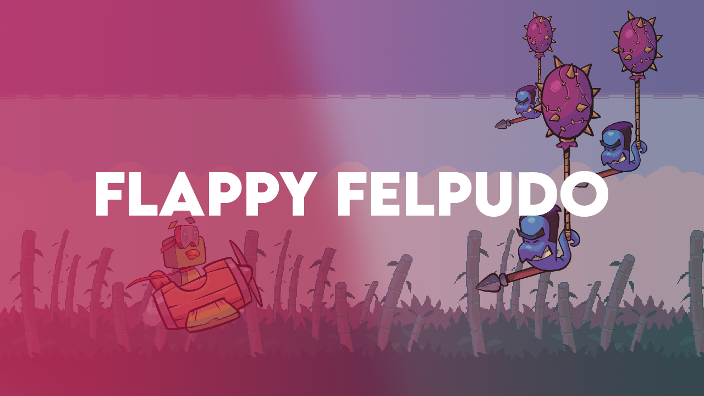

# Flappy-Felpudo

Game developed for the **Game Programming** course. Created using the Unity Engine (version `6000.3.4f1`) and published on Unity Play.

> Advisor: Murilo Boratto  

---

Play the game clicking [here]()

