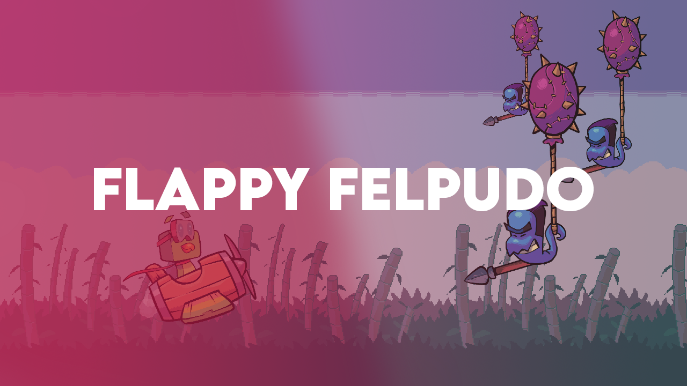

# Flappy-Felpudo

Jogo desenvolvido para a disciplina de **Programação de Jogos**. Criado utilizando a Unity (versão `6000.3.4f1`) e publicado no Unity Play.

> Orientador: Murilo Boratto  

---

Jogue clicando [aqui](https://play.unity.com/en/games/653187e2-bbaa-4f8c-9a12-df0955531ba6/flappy-felpudo)

https://github.com/user-attachments/assets/6f35be67-ab14-422e-b325-55fcbbec1c26

### Assets
Efeitos sonoros: 
https://www.youtube.com/watch?v=CFXoTXQ_h_E 
https://www.youtube.com/watch?v=V-GOtQlJ1HE

Musica:  
https://www.youtube.com/watch?v=8GltUyUIUto 
